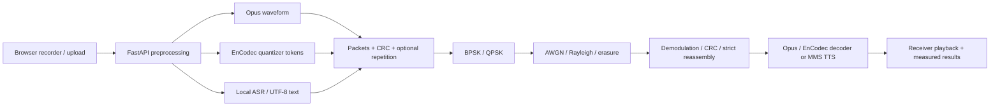

# iTantra
### Indian Multilingual TTS & STT Aided Neural Transceiver Radio Access for Low-Bitrate Links

A local research application comparing **Opus waveform transmission**, **EnCodec neural tokens**, and **speech-to-text / text-to-speech semantic transmission** through a real numerical digital-radio simulator. The dashboard never substitutes sender information for missing receiver packets.

**This is software simulation, with no physical RF hardware.** The application is a validated research prototype, not a production telephony system. Pretrained models are distinct from the separately trainable analog latent-channel experiment.

## What works
- Nine connected React pages: overview, transceiver, channel lab, speech lab, compression, analytics, voice turns, research and history.
- Microphone record/pause/replay and WAV/MP3/WebM/Ogg/FLAC/M4A uploads, mono preprocessing, provider-specific resampling, measured waveform/STFT.
- CPU int8 Faster Whisper for the baseline, native Kannada Vakyansh CTC routing, local MMS VITS synthesis, real FFmpeg Opus and 10-bit packed EnCodec tokens.
- BPSK/QPSK; ideal, AWGN and coherent IID flat Rayleigh fading; packet erasure and controlled bit flips; CRC32 and repetition-3.
- Strict packet validation, Unicode-safe semantic transport, explicit whole-payload failure on missing packets.
- Measured bit accounting, raw BER, packet outcomes, compression, computation/airtime, optional reference WER/CER, waveform SI-SDR.
- Seeded sweeps, asynchronous mode-comparison jobs, cancellation at stage boundaries, SQLite history, JSON/CSV exports and audio deletion/retention.
- Explainable adaptive mode recommendations; separate trainable PyTorch analog latent-channel experiment.

## Architecture


## Windows setup
Python 3.10+ and Node 22+ are recommended. CPU is sufficient. From this directory:
```powershell
powershell -ExecutionPolicy Bypass -File scripts/setup.ps1 -WithModels
.venv/Scripts/python.exe -X utf8 scripts/download-models.py --stt --tts en hi kn --neural
.venv/Scripts/python.exe -X utf8 scripts/verify-models.py
powershell -ExecutionPolicy Bypass -File scripts/start-dev.ps1
```
On the machine where this project was built, the virtual environment and these model checkpoints are already installed. That environment reuses the existing CPU PyTorch installation through `--system-site-packages`; setup on a fresh machine installs its own requirements.

Frontend: **http://127.0.0.1:5173** · Backend: **http://127.0.0.1:8000** · API docs: **http://127.0.0.1:8000/docs**.

Separate foreground terminals:
```powershell
powershell -ExecutionPolicy Bypass -File scripts/start-backend.ps1
powershell -ExecutionPolicy Bypass -File scripts/start-frontend.ps1
```
Stop launched background processes: `powershell -ExecutionPolicy Bypass -File scripts/stop-dev.ps1`.
Logs are in `storage/logs/`. The backend binds to loopback; there is no authentication for LAN deployment.

## First transmission
Open Transceiver Studio. Upload a short speech recording or permit microphone access. Choose a language, mode and **Ideal** channel for a deterministic first demonstration. Start Transmission. Compare source and receiver audio; inspect packets and actual bit counts. For Semantic mode, the recognized and recovered transcripts appear separately. The explicit text checkbox bypasses STT and is labeled accordingly.

Repeat using AWGN, Es/N0 12–20 dB, and seed 42. Set packet erasure to 100% to demonstrate honest failure. Compression uses the same sample for both codecs on the ideal channel. Performance Analytics runs A/B/C under the same channel and seed.

## Model and language status
The API `/api/v1/capabilities` reads actual checkpoints and executed verification evidence. English, Hindi and Kannada TTS are installed on the build machine. Whisper small is multilingual but weak on low-resource language recognition; inference smoke testing is not a human-speech quality benchmark. Tamil, Telugu and Malayalam have registry and Unicode coverage but their TTS checkpoints require explicit installation:
```powershell
.venv/Scripts/python.exe -X utf8 scripts/download-models.py --tts ta te ml
```
MMS and EnCodec weights are **CC-BY-NC-4.0**, suitable for noncommercial research subject to their terms. Whisper code/model terms are MIT. Third-party weights are not covered by this repository's MIT license. Nothing downloads during application startup or runtime inference.

## Kannada ASR improvement and current language coverage

The current `.env` selects `ITANTRA_KANNADA_STT=vakyansh`. Only Kannada changes provider; all other languages retain the existing Whisper pipeline. The checkpoint is pinned at `0564782ee3f5a47f1db8af94bcdc942bb0d5bb29`, converted locally with restricted `weights_only=True` loading, and served from safetensors without remote code or runtime downloads.

| Language | STT in this installation | TTS | Complete speech path |
|---|---|---|---|
| English | Whisper small, synthetic sample tested | MMS eng tested | Verified on synthetic speech |
| Hindi | Whisper small, errors measured | MMS hin tested | Verified on synthetic speech |
| Kannada | Vakyansh CTC, native script tested on 3 samples | MMS kan tested | Verified on synthetic speech |
| Tamil | Whisper checkpoint installed; language unverified | Not installed | Unavailable |
| Telugu | Whisper checkpoint installed; language unverified | Not installed | Unavailable |
| Malayalam | Whisper checkpoint installed; language unverified | Not installed | Unavailable |

To prepare Kannada ASR on a fresh installation:
```powershell
.venv/Scripts/python.exe -X utf8 scripts/download-models.py --kannada-asr
# Edit .env: ITANTRA_KANNADA_STT=vakyansh, then restart the backend.
```
`.env.example` retains `whisper` as the safe baseline until the optional CTC download is performed. An explicitly selected missing CTC provider returns an installation error rather than silently falling back. Network download is about 378 MB; retaining the source and converted checkpoint uses about 756 MB disk space.

The upstream Vakyansh project lists MIT, but the Hugging Face conversion has no explicit model-card license. Its weights remain ignored and are not redistributed with source. Resolve redistribution/commercial terms before such use. See `docs/KANNADA_ASR.md` for provenance and measured errors. Smoke testing proves the pipeline executes, not accuracy on human speech.

## Tests and reproducible experiments
```powershell
powershell -ExecutionPolicy Bypass -File scripts/run-tests.ps1
# With both servers running and model smoke fixtures generated:
Set-Location frontend
npx.cmd playwright install chromium
npm.cmd run test:e2e
Set-Location ..
.venv/Scripts/python.exe scripts/compare_channel_models.py
.venv/Scripts/python.exe -X utf8 scripts/compare-modes.py --audio research/results/smoke/en-synthetic.wav --language en --snrs 4 8 12 20
.venv/Scripts/python.exe -X utf8 scripts/prepare-synthetic-research.py
.venv/Scripts/python.exe -X utf8 scripts/train_neural_transceiver.py --epochs 12
.venv/Scripts/python.exe -X utf8 scripts/evaluate_neural_transceiver.py
.venv/Scripts/python.exe scripts/plot_training_history.py
```
Latest API/browser checks and receiver WAVs: `research/results/resume-2026-10-13/`. Radio results: `research/results/radio/`. Model smoke results: `research/results/smoke/`. Mode comparison: `research/results/modes/`. Latent-channel training/evaluation: `research/results/latent/`. Results and checkpoints are intentionally ignored by Git. See `docs/VERIFICATION_REPORT.md` for build-machine evidence.

## Research boundaries
SNR is **Es/N0**, average symbol energy is one. Rayleigh assumes perfect channel state information and independent fading per symbol. Packet boundaries and session knowledge are supplied by the simulator; no synchronization, physical MAC, SDR or retransmission exists. Missing packets fail the complete Ogg/EnCodec/text container. Gross link rate and wire bits per original speech second are separate metrics; symbolic airtime is not measured physical throughput.

No verified human corpus or listening study was collected. Synthetic speech proves integration only. WER/CER need a supplied reference, use NFC and whitespace WER, and are not equally informative across scripts. SI-SDR applies only to waveform codecs. STOI/PESQ and speaker-identity scores are unavailable. The analog neural extension transmits floating-point latents and has no digital bitrate claim. Docker is optional and has not been validated unless the verification report states otherwise.

Audio is retained locally for 24 hours by default, with expiration checked at startup and periodically. Delete session artifacts in History. Deleting a shared source affects playback of other sessions using that source. Model downloads are public HTTP fetches; inference sends no recordings externally.

## Source layout
`frontend/src/pages/` UI; `backend/app/` REST/schema/database/jobs; `backend/radio/` packets/DSP; `backend/speech/` registry/providers; `backend/audio_codecs/` conventional/neural/semantic; `backend/transceiver/` orchestration/rules; `backend/experiments/` trainable features; `scripts/` Windows operations and research; `docs/` implementation documentation.

Git is initialized. No commits, pushes or remotes were created.


Verified on 13 October 2026: English and Hindi semantic speech round trips use local Whisper small; Kannada now uses a pinned public Vakyansh wav2vec2 CTC checkpoint and completed three synthetic speech round trips with native-script text. The old Whisper Kannada wrong-script failure remains in historical evidence. Tamil/Telugu/Malayalam TTS checkpoints are not installed; their shared Whisper checkpoint is present but language-specific recognition quality is not verified. No human-speech accuracy benchmark exists.
